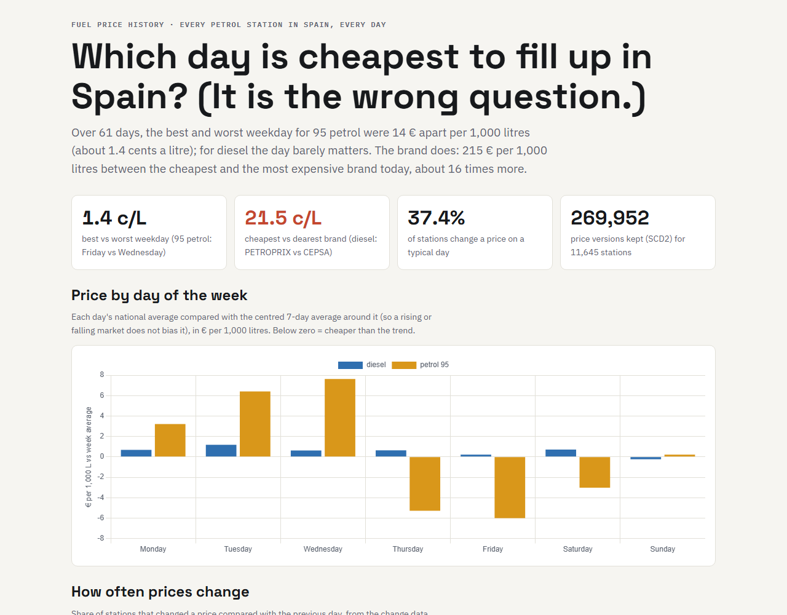
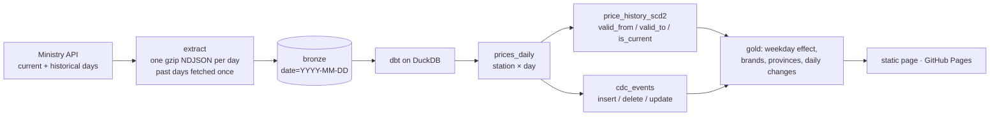

# Fuel Price History

[](https://github.com/jonathantorresdata/fuel-price-history/actions/workflows/ci.yml)

**Which day is cheapest to fill up in Spain?** A daily pipeline over the prices of every petrol station in Spain (~11,500) that keeps their full history as **SCD type 2** versions and derives **change data capture** (openings, closures, price changes) from a source that only publishes snapshots.

**Live page:** https://jonathantorresdata.github.io/fuel-price-history/



## What the data says (61 days, Sep–Nov 2026)

- **The day barely matters; the brand does.** Best vs worst weekday for 95 petrol: about **1.4 cents/L**, and almost nothing for diesel. Cheapest vs dearest brand for diesel today: **21.5 cents/L** (Petroprix 1.735 €/L vs Cepsa 1.950 €/L), about 16 times more.
- **A trap avoided.** Compared with its calendar week, Monday looked 2.4 cents/L dearer. Petrol fell 17.7 cents/L over the period, so that was the trend, not the weekday. [ADR 0003](docs/adr/0003-detrend-before-comparing-weekdays.md)
- **Prices move constantly.** On a typical day 37% of stations change a price.

## How it works



| Concept | Implementation |
|---|---|
| **SCD type 2** | Gaps and islands: `lag` flags a price change, a running `sum` numbers the versions, `lead` closes each one. 61 days × 11,500 stations → ~270,000 versions. [ADR 0001](docs/adr/0001-scd2-with-gaps-and-islands.md) |
| **CDC** | Full outer join of each day with the previous one → insert / delete / update. [ADR 0002](docs/adr/0002-cdc-by-comparing-snapshots.md) |
| **Idempotent backfill** | Past days are immutable files fetched once; today is refreshed on every run. |
| **Tests (11 dbt + 4 unit)** | One current version per station; versions never overlap or leave gaps; stations today = yesterday + inserts − deletes; one row per station and day; price ranges. |

## Run it

```bash
git clone https://github.com/jonathantorresdata/fuel-price-history.git
cd fuel-price-history
python3 -m venv .venv && source .venv/bin/activate
pip install -r requirements.txt
python scripts/run_pipeline.py --days 60      # first run downloads 61 days (~12 MB each, kept slim)
python -m pytest -q
```

Data: [Ministerio para la Transición Ecológica y el Reto Demográfico](https://geoportalgasolineras.es/), public REST service of fuel prices.
